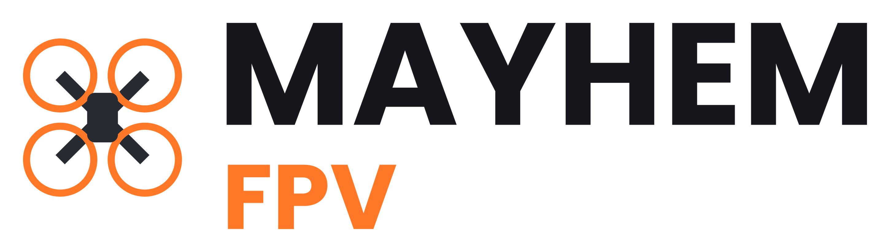
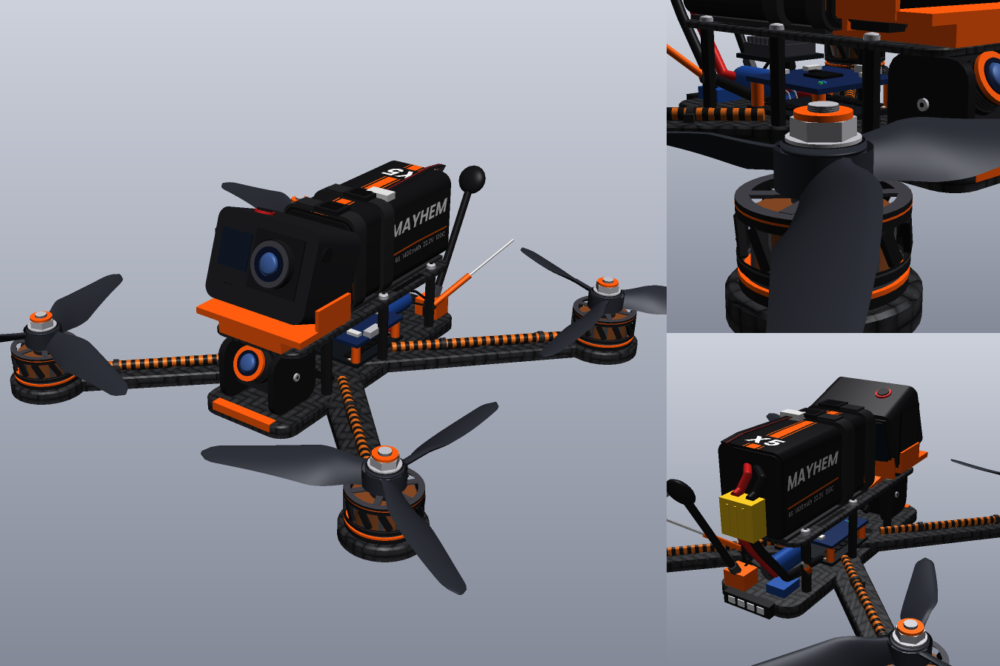

  <picture>
    <source media="(prefers-color-scheme: dark)" srcset="branding/mayhem_fpv_logo_white.png">
    
  </picture>

<b>FPV drone simulator</b> · open beta

## FPVjoy Installation

1. Download the `gmcl_fpvjoy_win64.dll` from the release.
2. In Steam: Garry's Mod > Manage > Browse local files.
3. Put the module to `\garrysmod\lua\bin`

## Credits

- **MityaFPV**: code, design, menu, MayhemPhys, models
- **Claude (Anthropic)**: code helper, troubleshooting, fpvjoy module, radio controller, rates and Betaflight firmware connection

Thanks to the open-source [Betaflight](https://github.com/betaflight/betaflight) firmware.

## License

The code is released under the [MIT License](LICENSE). The music in `addon/mayhem_fpv/sound/mayhem_music/`
is not covered by it and belongs to its respective copyright holders.